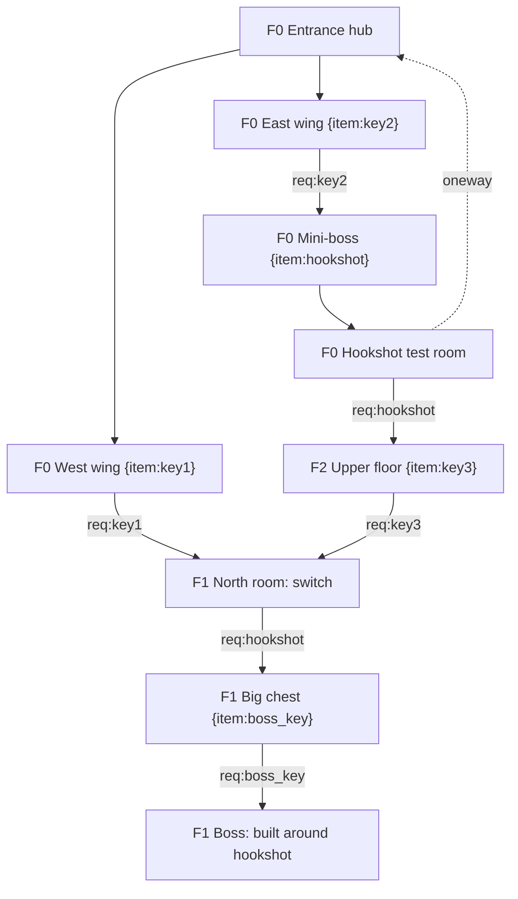

# Zelda-like Dungeons, Metroidvanias and Interconnected Worlds

## Contents
1. Universal rules (lock-and-key spaces)
2. Mission before space: designing the graph first
3. Checking the graph with `graph_check.py`
4. Zelda dungeons: item loop, structure, bosses
5. Dungeon-as-machine: Water Temple and Divine Beasts
6. Vertical structure: shafts, "see it, then reach it" loops, Stormveil's lesson
7. Metroidvanias: ability gates and guidance
8. Maps, saves, fast travel and backtracking
9. Sequence breaking
10. Review checklist
11. Levels to study

> Confidence tags: untagged claims come from developer statements, primary sources or well-documented analyses (see `SOURCES.md`). **[convention]** = practitioner practice or a tunable default with no source behind the number. **[contested]** = sources disagree. **[unverified]** = could not be checked; don't quote it as fact.

Core refs: topology patterns (hub-and-spoke, loops, gating) in `layout-and-flow.md`; height functions, drop bands and the hidden-but-fair rule in `verticality.md`; teaching theory in `principles.md`; room puzzles and dependency charts in `puzzle-craft.md` and `puzzle-sequencing.md`; boss rooms in `boss-arenas-and-raids.md`; traversal metrics in `metrics.md`.

---

## 1. Universal rules

- **These are lock-and-key spaces.** Locks are obstacles; keys are small keys, switches, items or abilities. The level is a dependency graph folded onto a connected map (Mark Brown, Boss Keys).
- **Locks speak one visual language.** Zelda's Boss Key always sits in a large, distinct chest and opens only that dungeon's boss door; Super Metroid's doors and blocks show whether the player has the needed item. One lock type = one look, everywhere, forever.
- **Show the lock before the key.** [convention] The player sees a lock, fails to open it and remembers it, so finding the key triggers a plan to return. Put such locks near hubs or on routes passed often.
- **Every new key pays off quickly and repeatedly.** [convention] An opening close by, then more across the space.
- **Never soft-lock.** Missing an item, a detour or out-of-order acquisition must not strand the player. Super Metroid "always leaves a back door."
- **The world state is readable**: what is open, what is locked, what configuration the space is in.
- **Never assert soundness.** "Every key is reachable before its lock" is a claim to check with the script (§3) or label "hand-traced, not machine-verified".

## 2. Mission before space: designing the graph first

- **Separate the mission from the space.** Dormans ("Adventures in Level Design", PCG Workshop 2010): "a level generally consists of a mission and a space"; generate "missions first and then generate spaces to accommodate these missions." "The same mission can be mapped to many different spaces, and one space can support multiple different missions." Write the mission graph (tasks, keys, locks, order), then fold it into rooms.
- **Case study: Twilight Princess's Forest Temple** (Dormans). Link learns the bomblings, then the boomerang, each in kihon → kata → kumite steps (basic technique repeated → combinations → applied), and applies both against the boss. Use the three steps as the dungeon item's teaching arc (§4), alongside Hayashida's four beats.
- **Structure can differ from layout.** Once Zelda II's dungeons are graphed they "almost look like normal Zelda dungeons" (Brown).
- **Relations are not only one-to-one.** Link's Awakening's crystal switches are "many keys for one giant lock"; the ball is "a single key for four locks". Use many-to-one and one-to-many to vary the graph's shape.
- **Measure linearity.** [convention] One chain is linear; parallel branches that merge are not. Hide a chain's linearity by folding it: loops back to the hub, keys in one wing opening doors in another. Boss Keys finds A Link to the Past and Link's Awakening dungeons often more non-linear than later 3D ones; Twilight Princess's are largely linear.
- **Boss Keys notation** (Brown; Partially verified: known from extracts of his notation post). Red diamonds = keys, red squares = locks; orange = the dungeon item and the obstacles it clears; blue = boss key and boss door; lettered green = switches. Start graphing from what is reachable at the entrance. Adopt it, or the Mermaid form below, but use one notation per project.

## 3. Checking the graph with `graph_check.py`

Write the graph in the script's input format, run it, and report its numbers verbatim (core stance 13). Run from the skill root:

```
python3 -I scripts/graph_check.py dungeon.json            # human-readable summary
python3 -I scripts/graph_check.py dungeon.mmd --format mermaid --json
```

JSON is the canonical input: `{"start": "E", "goal": "BOSS", "nodes": [{"id": "W", "items": ["key1"], "label": "West wing"}], "edges": [{"from": "W", "to": "C", "requires": ["key1"], "oneway": false, "consumes": true}]}`. Set `"consumes": true` for small keys that are spent; set `"oneway": true` for drops and one-way doors. The Mermaid subset uses `A -->|req:key1| B`, dotted `A -.->|oneway| B` for one-way edges, `A <--> B`, and node items as `A["Hall {item:key1}"]` (see `--help` for how start and goal are named in Mermaid input). Example, a classic small dungeon with floor indices in the labels:



Read the report and act on each line:
- **Goal reachable / reachable %:** below 100% means content is cut off; find which lock blocks it.
- **Unreachable required items:** a key sits behind its own lock or behind a lock whose key comes later. Move the key or the lock.
- **Key-before-door order:** the topological progression. Compare it with your intended beat chart; if the dungeon item arrives later than planned, the second half is too short.
- **Consumed-key softlocks:** a small key spent on an optional door leaves a required door locked. Add a key, make the optional door non-consuming, or gate it after the required one.
- **Dead-end nodes:** every dead end needs a payoff (item, vista, shortcut) or a reason.
- **Cycle count:** zero cycles means a tree with walk-backs; add loops back to the hub (§6).
- **One-way edges with no return path:** a drop with no way back to the hub; add a lift, ladder or door that opens from the far side.
- **Sequence-break and teaches tests:** copy the graph, delete an ability from its node, re-run. If the goal stays reachable, the ability isn't required (fine if intended). Remove each ability in turn to confirm no state soft-locks.
- The script models graph logic only (it prints a "Not modelled:" line: distances, combat, timing, whether the player notices a route). Noticing is the hidden-but-fair rule's job (§6).

## 4. Zelda dungeons: item loop, structure, bosses

- **Dungeons "constantly teach."** Taylor uses Zelda dungeons as the archetype: each introduces, tests and reinforces an item (`principles.md`).
- **Teach-use-master loop for the dungeon item.**
  1. **Find:** the midpoint reward, often guarded by the mini-boss. [convention]
  2. **Teach (kihon):** a safe room right after, where the item's basic use is the only way forward.
  3. **Use (kata):** the item opens new locks through the second half, each a small variation.
  4. **Master (kumite):** the boss is built around the item.
  5. **Revisit:** the item opens overworld locks afterwards (the Oracle games formula).
- **Typical structure.** [convention] Entrance → small-key loop(s) → mini-boss guarding the item → item-gated second half → Boss Key → boss. Map and compass are optional aids.
- **Bosses test, mini-bosses gate.** [convention] Save or safe room right before the boss door; arena detail in `boss-arenas-and-raids.md`.
- **Small keys are sequencing tools.** Treat each as a deliberate "do this before that".
- **Shrines vs dungeons.** Fujibayashi: with 100+ shrines planned, long dungeons would keep players inside too long, so BotW spread puzzles across shrines. Decide how much puzzle content lives in long dungeons vs short rooms.

## 5. Dungeon-as-machine: Water Temple and Divine Beasts

- **Water Temple (Ocarina of Time).** Six small keys plus map, compass, Longshot and Boss Key meant "it's easy to miss something"; players got stuck on one key in a room passed through once, behind a bombable wall at one water level.
  - Avoid global state changes that make cleared rooms hide new keys, and keys in pass-through-once rooms.
  - Make the current state readable; let the player change state from where they are. [convention] The 3DS remake added coloured guide lines and fewer trips to change the water.
- **Divine Beasts (BotW).** One machine, manipulated from a map-screen control: creative navigation, but some puzzles too easy; any-order objectives, but players aren't pushed to learn the whole space; no small keys, so weaker "what next" signalling.
- **Rule:** freedom costs guidance. With global toggles or free order, add state readouts, landmarks and a "what's left" display. [convention] Eagle's Tower (lower the floor by breaking pillars) is the sequenced counterpart; TotK's temples return to themed, sequential traversal.

## 6. Vertical structure: shafts, "see it, then reach it" loops, Stormveil's lesson

Height is how interconnected worlds fold long routes into small footprints (`verticality.md` covers all eight functions).
- **Vertical shafts as hubs with several locks.** Shafts act as branching hubs: many side rooms can't be fully explored on first visit, so returning through the shaft with new abilities is cheap. [convention] Put several different ability locks on each shaft (a high ledge, a grapple point, a breakable floor) so every new ability opens something in a place the player already knows. Draw the shaft as a section with floor indices.
- **See it, then reach it from an unexpected height.** The FromSoftware method (TheGamer on Dark Souls; Elden Ring analyses, opinion pieces):
  - **Preview:** Blighttown "can be seen from Firelink Shrine itself below the cliff"; an Ainsel side path gives "a preemptive view of the Lake of Rot". Seeing it plants a goal.
  - **Loop:** circling through Darkroot leads to the Undead Parish, whose lift drops "right back down to Firelink Shrine": the player learns they were above the hub all along. End each long stretch with a vertical shortcut to a known safe point.
  - **Reuse the footprint:** Carian Study Hall "inverts its entire structure" so the climb becomes a descent; the Divine Tower of Caelid makes going down "an enormous space which… was never meant to be gone down" into a puzzle, "even a sconce may serve as a platform."
  - **Visible vs secret entrances:** Siofra River Well's lift sits "in plain sight", trading surprise for accessibility; Dark Souls' Great Hollow hides behind an illusory wall. Critical layers get visible entrances; optional ones may hide.
- **Stormveil's lesson.** The castle's opening is "designed to encourage and teach verticality" with items and enemies (birds) overhead, "forcing them to look up". But critics found it "incredibly linear and punishing" for players who did not realise "they could jump off the ledge and navigate the castle's lower rooftops" (JM8, The Escapist, via Wikipedia). A hidden route nobody finds turns a branching level into a linear, punishing one.
- **The fix: hidden-but-fair** (`verticality.md`; synthesis, [convention]). A vertical route is fair when (1) its grammar was taught in a safe spot, (2) it is visible from at least one other vantage, (3) something invites a look over the edge (glint, corpse, light below, an enemy patrolling beneath), and (4) trying costs little. Optional routes may skip (2); critical-path routes may not.
- **Graph it.** Mark drops as one-way edges and lifts/ladders as two-way in the graph (§3) so the script flags drops with no return path.

## 7. Metroidvanias: ability gates and guidance

- **"Always has a clearly best path, but never depends on the player following it."** Super Metroid: legible main progression, detours allowed, back doors everywhere.
- **Ability gates gate rooms, then invite backtracking.** Each lock gets a unique, consistent signature seen before its key [convention]: door colours, bomb blocks, grapple points, crumbling walls.
- **Start from a fixed path and loosen.** Team Cherry started Hollow Knight from the world's shape and a fixed power-up path, then loosened it; many power-ups became optional, and minimal-ability speedruns are a success to them. Build the strict path, verify it (§3), then add alternate routes.
- **Suggested-path techniques.** [convention] One-way drops that commit, passages collapsing behind the player, diegetic direction (Dread's Chozo statues).
- **Soft gates.** [convention] Symphony of the Night's levelling, and its inverted castle recontextualising the whole map.
- **Danger zones as pacing spikes.** Dread's EMMIs are "fear-based gameplay"; after a game over players should "know what to try on their next attempt." [convention] Save rooms at EMMI-zone thresholds keep retries short.

## 8. Maps, saves, fast travel and backtracking

- **The map is a mechanic.** [convention] Auto-map favours flow; a bought or partial map (Hollow Knight) favours being lost. Mark points of interest either way. Stacked areas need a map that shows layers (`genre-open-world.md` §5).
- **Hollow Knight's map loop.** Cornifer is signposted by paper trails and humming; maps are bought and fill in at benches after the Quill. If you hide the map, signpost the mapmaker with two independent cues.
- **Save spacing.** [convention] A save before every boss and every few minutes of travel; sparse saves (Super Metroid) need short boss retries. Check replay cost per death (`fun-checks.md`).
- **Fast travel.** [convention] Unlock it mid-game, once backtracking drags; nodes near hubs and late-game lock clusters.
- **Shortcuts over walks.** [convention] After a key ability, open a loop back to the hub; doors that open from the far side are cheapest. Mark unopenable locks on the map (Dread).

## 9. Sequence breaking

- **Decide per gate** which are hard and which are skill-skippable. [convention] Super Metroid's wall- and bomb-jumps bypass gates.
- **Robust critical path.** Every key-reachable state must stay completable; run the remove-each-ability test (§3).
- **Reward breaks.** [convention] An early ability, shortcut or secret is a payoff; locked-out content or a broken trigger is not.
- [convention] Axiom Verge builds sequence-bending into its toolset (glitch and address-disruptor mechanics as locks and secret-revealers).

## 10. Review checklist

- [ ] Mission graph written before geometry (Dormans); one notation used (Mermaid or Boss Keys)
- [ ] `graph_check.py` run: goal reachable, 100% reachable or cut content explained, no unreachable required items, no consumed-key softlocks; numbers reported verbatim (or "hand-traced, not machine-verified")
- [ ] Remove-each-ability runs done: no state soft-locks; breaks are intended
- [ ] Mix of one-to-one, many-to-one and one-to-many relations; linearity chosen deliberately
- [ ] Each lock type has one look; locks seen before keys
- [ ] Dungeon item: kihon teach room → kata varied uses → kumite boss → overworld payoff
- [ ] Global state changes readable and changeable from where the player is; no key in a pass-through-once room
- [ ] Freedom balanced with "what's left" guidance
- [ ] Vertical shafts carry several different locks; section drawn with floor indices; ≤3 floor planes per area
- [ ] At least one "see it, then reach it" payoff and one vertical shortcut back to a safe point
- [ ] Every hidden vertical route passes hidden-but-fair; no critical route depends on an untaught drop (Stormveil test)
- [ ] Dead ends have payoffs; cycles exist; every one-way drop has a return path to the hub
- [ ] Saves before bosses/danger zones; fast travel before backtracking drags; layers shown on the map
- [ ] Danger-zone failures tell the player what to try next

## 11. Levels to study

- **Zelda:** A Link to the Past (Palace of Darkness, Skull Woods); Link's Awakening (crystal switches, Eagle's Tower); Ocarina of Time Water Temple (original and 3DS); Twilight Princess Forest Temple (Dormans' case study; also a linear comparison); BotW Divine Beasts; TotK Wind Temple.
- **Metroidvania:** Super Metroid (Crateria to Brinstar, back doors, vertical shafts); Symphony of the Night (inverted castle); Hollow Knight (Forgotten Crossroads, City of Tears, Cornifer's map loop); Metroid Dread (EMMI zones); Axiom Verge.
- **Interconnected / vertical:** Dark Souls (Firelink–Undead Parish–Blighttown); Elden Ring (Stormveil as both lesson and warning; Carian Study Hall; Divine Tower of Caelid; Siofra River Well).

Key sources (full list in `SOURCES.md`): Dormans 2010 (PDF); Mark Brown, Boss Keys and notation post; Game Developer ("The Invisible Hand of Super Metroid"); PC Gamer (Team Cherry); TheGamer (Dark Souls interconnection); "The Best of Elden Ring's Level Design" (Substack); Wikipedia summarising The Escapist on Stormveil; Zelda Dungeon (Water Temple); Kotaku (Divine Beasts).
