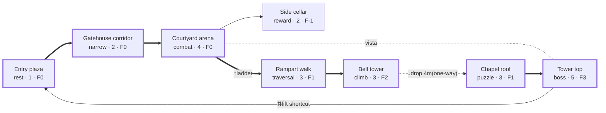

# Layout and Flow

## Contents
1. Layout vocabulary and process
2. Topology patterns
3. Taming 3D connectivity: spirals, Swiss cheese and window panes
4. Gating, valves and shortcuts
5. Critical path
6. Circulation
7. Dead ends and branches
8. Orientation and wayfinding
9. Reveals, framing and sightlines
10. Verticality (summary)
11. Drawing the bubble diagram (Mermaid)
12. Review checklist

> Confidence tags: untagged claims come from developer statements, primary sources or well-documented analyses (see `SOURCES.md`). **[convention]** = practitioner practice or a tunable default with no source behind the number. **[contested]** = sources disagree. **[unverified]** = could not be checked; don't quote it as fact.

---

## 1. Layout vocabulary and process

- **Flow** is how movement through a level feels. Plan it at layout time, but "you won't be able to verify how it actually feels until you blockout and playtest" (The Level Design Book, TLDB). A layout is a hypothesis.
- **TLDB sequence:** parti thumbnails → bubble diagram (ovals to "establish proportions and relationships") → top-down plan (footprint and connectivity) → section for any multi-floor area → blockout. Draw 3–5 partis before committing [convention].
- **Typology** = "a layout design pattern". Name the pattern for every room and for the level; a named pattern brings known failure modes. TLDB vocabulary: corridor, switchback, combat bowl ("Ring Around The Rosie"), arena; hub-and-spoke, loopback, string of pearls (branching chokepoints), pass-through, time cave; multiplayer figure 8, three lane, sniper alley.
- Real levels nest patterns: a hub of linear spokes, each ending in a ring.

## 2. Topology patterns

| Pattern | Use when | Failure modes | Fix |
|---|---|---|---|
| **Linear / corridor** | Tutorials, set pieces, story beats, tight pacing [convention]. | Monotony; arena-to-arena repetition; no agency. | Vary width, height and light (compress/release); side pockets; a curve hides the next beat. |
| **Curving path, goal in view** | Long approaches; Naughty Dog curved Uncharted paths so players keep facing the objective. | Straight path shows everything; too tight a curve loses the goal. | Bend so the camera's natural facing lands on the landmark at each turn. |
| **Loopback** | "A linear progression that loops back on itself" (TLDB); dungeons. | Contrived return ("a door that happens to be there"). | Player recognises the start from a new angle, ideally after seeing it from above or across a gap. |
| **Ring / combat bowl** | Room-scale combat: rotating flow, chase, flank, no dead ends. DOOM 2016 arenas loop around central structures for repositioning and gaining height. | Pillar too small to break LOS; one side dominant. | Pillar fully breaks LOS; sides differ (height, cover, pickups) but both viable. |
| **Hub-and-spoke** | Gated progression around a safe node (Firelink Shrine) [convention]. | Long return trips; hub is a corridor, not a place. | Each spoke ends with a shortcut to the hub; hub landmark visible from spoke mouths; hub changes as spokes complete. |
| **Branching & reconverging** | Cheap choice: 2–3 routes that rejoin (stealth vs combat, high vs low) [convention]. | One branch clearly better; rejoin invisible, so players fear missing content. | Distinct play style or risk/reward per branch; show the rejoin. |
| **Network / open** | Open worlds, immersive sims, multiplayer. | Hard to pace; missed content; disorientation. | Global landmarks; soft gates; tuned density (`genre-open-world.md`). |
| **Vertical loop / spiral** | Dense sandboxes and hubs: the level wraps around and over itself (Hitman's "snail house"; Dark Souls' Undead Parish lift down to Firelink). | Players can't model which floor connects where. | Floors players can name; slopes and stairs as the connective tissue; a return to a known place at each turn (§3, `verticality.md`). |
| **Stacked layers** | Worlds or levels with whole layers above/below (TotK sky/surface/Depths; Titanfall 2's "Effect and Cause", two copies of a level "one floating directly above the other"). | Map illegibility; "close" places that are hours apart (Shadow of the Erdtree critique). | Layered map or diegetic equivalent; each layer distinct in light and material; access points visible (`verticality.md` §7). |
| **Lock-and-key** | Dungeons and metroidvanias. | Key far from lock with no reminder. | `genre-dungeon-metroidvania.md`; check with `scripts/graph_check.py`. |

**Deliberate disorientation** is a tool (P.T.'s looping corridor), not a default. Outside horror and labyrinths, treat it as a bug.

## 3. Taming 3D connectivity: spirals, Swiss cheese and window panes

Unconstrained 3D connectivity becomes "a mess" (Titanfall 2's Steve Fukada). Three verified cures; pick one deliberately:
- **Swiss cheese with a spiral spine (Hitman).** Elverdam: "we built a volume filled with connections, and these connections mean that you will never get lost… You don't have to backtrack." Christensen: Sapienza and Hokkaido are "spirals, or a snail house" whose layers interconnect with slopes and stairways, so they feel bigger than they are. Use for sandboxes where the player should always have another way round. Note the building-type effect: a palace (floors, basement, attic) is easy to model; a coastal town is not, so it needs the spiral.
- **Window panes / lanes (Titanfall 2).** For wall-running in 3D, Respawn moved from "3D Swiss cheese" to "a 'window pane' effect… lanes. Defined paths become the norm: the left, the middle, the right." Use when movement is fast and three-dimensional and players must predict where threats come from (`genre-multiplayer.md`).
- **Legible machine (Dishonored 2's Clockwork Mansion).** Players must "construct a mental picture of the house"; every backstage area is "visually connected to the big areas". Use for transforming or hidden-layer spaces (`genre-stealth-immersive-sim.md`).
- In all three, cap distinct floor planes per area at about three (TLDB; `verticality.md` §6).

## 4. Gating, valves and shortcuts

- **One-way valves:** a drop, a door that locks behind, a collapsing bridge (Naughty Dog's Uncharted valves). They commit the player, protect pacing and cut the space you must make interesting behind the player. A valve must read as one-way *before* commitment [convention]. The cheapest valve is a drop: "With gravity, it is easier to drop down than to climb up" (TLDB).
- **Drop-as-valve with a visible return:** let the player see, from below, the ladder or lift they will later open back up. The return becomes a promise.
- **Shortcuts (FromSoftware).** A path that could be straight is bent into a circle; the far end of a dangerous stretch opens a door, lift or ladder back to safety (Undead Parish lift to Firelink). Show the locked side earlier so opening it reads as a shortcut. Playtest question: did they realise it was one?
- **Inverted footprint:** replay a space in the opposite direction with a changed rule (Elden Ring's Carian Study Hall flips so the climb becomes a descent). Taylor's "bi-directional gameplay… with a key modifier on the second pass".
- **Gate types** [convention]: hard (lock-and-key, ability, story/event), soft (difficulty, hazard, resource cost, untaught skill), information (route exists but must be noticed), valve (one direction). For every gate state what opens it, where the player learns that, and how the locked state is signalled.

## 5. Critical path

- "The critical path (or golden path) is the main intended player path" (TLDB). It is an ideal, not a prediction: "most players will wander, explore, linger, or even just get confused."
- Design it first, then test real paths against it; classify each divergence as intended, harmless or a guidance failure.
- Everything on it sits comfortably inside player capability (`metrics.md`) with ≥2 cues per decision (`principles.md` §2). Required information sits within normal camera pitch.
- Anything off it is seen by only some players; decide whether each optional space is worth building.

## 6. Circulation

- **Primary vs secondary** (TLDB: "path to main elevator vs. path to storage closet"). Primary reads as primary: wider, brighter, landmarked [convention for the cues].
- **Diegetic vs formal** (TLDB): what the route means in the fiction vs its "systemic function" (flank, rotation, resupply). Label each connection with both; a mismatch is a critique point.
- **Lanes:** multiplayer maps are lane systems, not one critical path (`genre-multiplayer.md`).

## 7. Dead ends and branches

- Classify every branch: critical, optional-with-reward, loop/shortcut, vista-only. A branch that fits none is a cut candidate.
- Dead ends are short, pay off (reward, vignette, vista, lore) and never read as an equal alternative to the main path at the fork.
- **Sight blockers** decide which door is seen first; make it the one you want.
- **Reward trick** [convention]: a player who guesses wrong and finds a short, visibly-ending reward branch feels clever, not lost.

## 8. Orientation and wayfinding

- For every fork, list which landmarks are visible from it and which way each points.
- **Global vs local landmarks** [convention]: one or two for the level (tower, mountain), local ones for nodes.
- **Vistas and survey points:** an early high vantage over the spaces to come lets players build a mental map (TLDB: vistas "preview landmarks, and offer layout information"). See `verticality.md` §2.
- **Foreshadow:** show the goal before the route exists (across a chasm, below a cliff, through a gate). It must look unreachable *for now*, with no false affordance.
- **BotW "gravity":** structures of varying visibility pull players in different directions (`principles.md` §2).
- **Re-entry landmarks:** a recognisable landmark where a loop rejoins confirms "I've been here" [convention].
- **Lost-player test** [convention]: a tester can point at start and goal at any moment and sketch a rough map afterwards, including which floor they are on.

## 9. Reveals, framing and sightlines

- **Reveals** [convention]: compress, then cross a threshold at walking pace into a wide, bright or high space; the first frame lands on the target. Vertical variant: compress low, then chain upward eye-leads (Portal 2's "The Ascent": tower, sparking cables, falling debris).
- **Framing** [convention]: doorways, arches, cave mouths around a landmark at the moment of entry.
- **Triangles and rectangles (BotW, CEDEC 2017):** large triangles are landmarks, medium ones block the view and pose over-or-around, small ones set the tempo; rectangles hide completely. Ridges and rises are reveal tools outdoors.
- **Sightlines** [convention]: match length to encounter design (long = ranged, planning; short = ambush). Break long lines with cover, a turn or a height change unless the view is the point. Check what the player sees, and what sees them, from every entrance. In stealth, sightlines are the core design object. Halo's Lockout shows where opponents head but not where they land; partial information is a target.

## 10. Verticality (summary)

Height is a primary design axis, not combat garnish; full method in `verticality.md`. In short:
- Use height for eight jobs: preview/survey, aspiration, memory/loopback, cheap commitment, footprint reuse, hidden routes, emotional meaning (ascent vs descent), combat/stealth position.
- "See it, then reach it from an unexpected height", made fair by the hidden-but-fair rule (grammar taught, visible from another vantage, invitation to look over the edge, low cost to try).
- Classify every drop free / committed / costly / lethal from the game's metrics; lookalike drops behave alike.
- About three floor planes per area; a section view for any space with ≥2 floor planes; critical cues within camera pitch.

## 11. Drawing the bubble diagram (Mermaid)

Nodes are spaces labelled with role, intensity (1–5) and floor index (`F0` ground, `F1`, `F2`…; negative for below ground, `F-1`). Use thick arrows (`==>`) and a `crit` class for the critical path. Label every edge that isn't a plain two-way walk:
- `gate: …`, `shortcut`, `one-way`;
- vertical edges: `↓drop(one-way)`, `↑ladder`, `⇅lift` (add the height, e.g. `↓drop 4m(one-way)`);
- one-way edges (including drops) use the dotted arrow `-.->`, which `scripts/graph_check.py` reads as one-way;
- sightlines are not routes: draw vistas as a dotted line with no arrowhead, `-. vista .-`.

Example: a small wing. The tower is foreshadowed from the courtyard; a drop commits the player; a lift is the shortcut home.

- Check the diagram: does every dead end (D) pay? Is there a route back to safety after the peak (H → A)? Does every one-way edge read as one-way before commitment?
- Any space with ≥2 floor planes also gets a **section (side) view** (`verticality.md` §8). Pair the diagram with a beat chart (`process.md` §4) and, where needed, an ASCII plan with a stated scale (`grid-conventions.md`).
- Keep diagrams under ~15 nodes; nest sub-diagrams for larger levels. For lock-and-key levels, run `scripts/graph_check.py` on the diagram and report its output verbatim.

## 12. Review checklist

- [ ] Topology named (linear / loop / ring / hub / branching / network / spiral / stacked / lock-and-key) and fits the intent
- [ ] 3D connectivity structured on purpose (spiral, window panes or legible machine), not ad hoc
- [ ] Critical path marked; every space on it within player capability; required cues within camera pitch
- [ ] Every decision point has ≥2 cues and a landmark visible from it
- [ ] Primary routes read as primary; connections labelled diegetic and formal
- [ ] Every branch classified; dead ends short, paid off, never equal to the main path at the fork
- [ ] Sight blockers show the intended door first
- [ ] Loopbacks feel inevitable; a shortcut back to safety after each dangerous stretch
- [ ] One-way valves (including drops) read as one-way before commitment
- [ ] Every gate: what opens it, where that is learned, how locked state is signalled
- [ ] At least one survey vista and one foreshadowed space that looks unreachable for now
- [ ] Reveals: compression first, first frame on the target, crossed at walking pace
- [ ] Sightline lengths match encounter design; long lines broken unless intended
- [ ] Verticality reviewed with the Z-axis checklist (`verticality.md`); section drawn for every multi-floor space
- [ ] Mermaid diagram carries roles, intensity, floor indices and vertical edge labels; graph checked where gated
